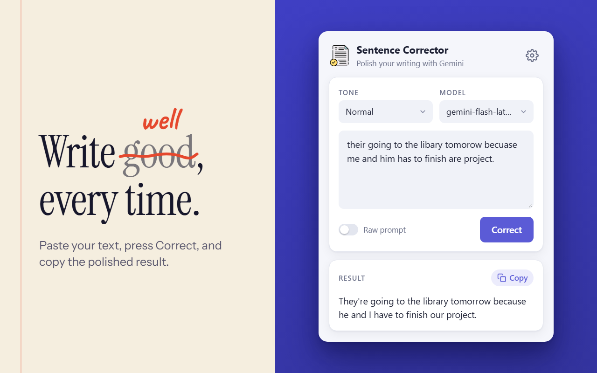
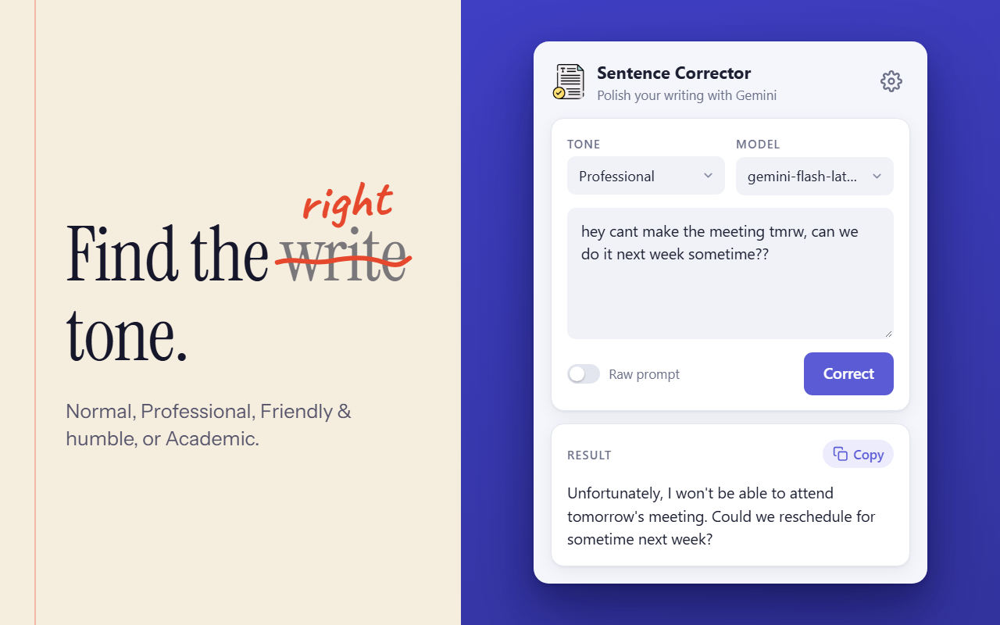
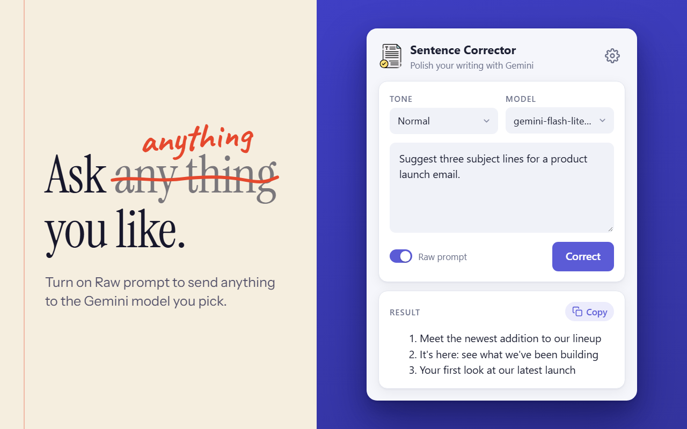
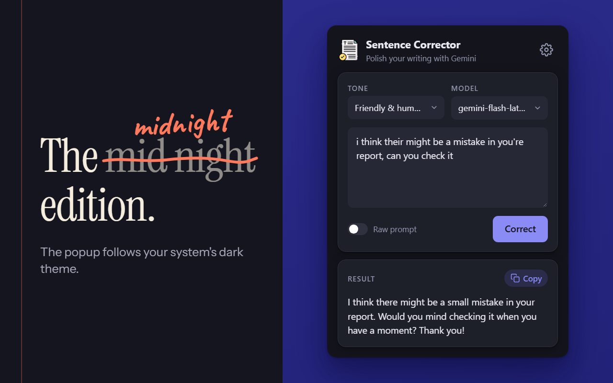

# Sentence Corrector Chrome Extension


**Correct your text effortlessly with AI-powered grammar and tone adjustments.**

The Sentence Corrector is a Chrome extension designed to enhance your writing by correcting grammatical errors and refining text with customizable tones. Powered by the Gemini Flash API, this extension offers a user-friendly interface to improve text quality, making it ideal for students, professionals, and writers. With secure API key management and a sleek popup UI, it ensures both functionality and privacy.

## Features

- **Grammar Correction**: Automatically fixes grammatical mistakes and enhances sentence clarity using AI.
- **Customizable Tones**: Adjust the tone of your text to Normal, Professional, Friendly, or Academic.
- **Secure API Key Storage**: Encrypts and stores API keys using AES-GCM with a device-specific key seed and optional passphrase for robust security.
- **Clipboard Integration**: Easily copy corrected text to the clipboard with a single click.
- **Responsive Design**: A clean, intuitive popup interface styled with CSS for a seamless user experience.
- **Raw Prompt**: Optional mode that bypasses the default correction prompt for advanced users.

## Screenshots



| Choose a tone | Send a raw prompt |
| --- | --- |
|  |  |

| Use your own API key | Dark mode |
| --- | --- |
|  |  |

## How It Works

1. **Input Text**: Paste or type your text into the extension's textarea.
2. **Select Tone**: Choose a tone (Normal, Professional, Friendly, or Academic) from the dropdown.
3. **Set API Key**: Securely enter and store your Gemini API key with an optional passphrase.
4. **Correct Text**: Click "Correct" to process your text via the Gemini Flash API.
5. **Copy Output**: Copy the corrected text to your clipboard for immediate use.

## Technical Details

- **Frontend**:
  - **HTML/CSS**: Popup UI with a modal for API key input, styled for responsiveness and accessibility.
  - **JavaScript**: Handles user interactions, API requests, and encryption/decryption logic.
- **Backend Integration**:
  - Integrates with the Gemini Flash API for text correction and tone adjustment.
  - Uses the `marked` library to render Markdown-formatted responses.
- **Security**:
  - **Encryption**: API keys are encrypted using AES-GCM with PBKDF2-derived keys (SHA-512, 250,000 iterations).
  - **Storage**: Encrypted API keys are stored in `chrome.storage.sync`, device-specific key seeds are stored in `chrome.storage.local`, and optional passphrases are held in memory only, in `chrome.storage.session`.
  - **Dynamic Key Derivation**: Uses random salts and a device-specific key seed for enhanced security.
- **Permissions**: Requires only the `storage` permission.

## Repository Structure

```
sentence-corrector/
├── css/
│   └── styles.css                  # Styles for the popup UI and API key modal
├── icons/
│   ├── 16px.png                    # 16x16 icon for the extension
│   ├── 32px.png                    # 32x32 icon
│   ├── 48px.png                    # 48x48 icon
│   ├── 64px.png                    # 64x64 icon
│   └── 128px.png                   # 128x128 icon
├── js/
│   └── popup.js            # Core logic for user interactions, API calls, and encryption
├── lib/
│   └── font-awesome.all.min.css    # Font-Awesome Icons
│   └── marked.min.js               # Minified marked library for Markdown parsing
├── screenshots/                    # Store screenshots, promo tiles, and store icon
├── popup.html                      # Main popup UI with textarea, tone selector, and modal
├── manifest.json                   # Chrome extension manifest file
├── LICENSE                         # MIT License file
└── README.md                       # Project documentation (this file)
```

## Installation

1. **Clone the Repository**:
   ```bash
   git clone https://github.com/Aftar-Ahmad-Sami/Sentence-Corrector-Extension.git
   ```
2. **Load the Extension in Chrome**:
   - Open Chrome and navigate to `chrome://extensions/`.
   - Enable "Developer mode" in the top-right corner.
   - Click "Load unpacked" and select the cloned repository folder.
   - **Firefox (140+)**: open `about:debugging#/runtime/this-firefox`, click "Load Temporary Add-on…", and select `manifest.json` in the cloned folder. (Temporary add-ons are removed when Firefox restarts; for a permanent install, publish/sign it via [addons.mozilla.org](https://addons.mozilla.org/developers/).)
3. **Obtain a Gemini API Key**:
   - Sign up for access to the Gemini Flash API and generate an API key.
4. **Set Up the Extension**:
   - Click the extension icon in Chrome.
   - Enter your Gemini API key and an optional passphrase in the popup modal.
   - Start correcting your text!

## Usage

- **Set API Key**: Open the extension, click the gear icon, enter your Gemini API key, and optionally provide a passphrase for added security.
- **Correct Text**: Input text, select a tone, and click "Correct" to receive AI-enhanced output.
- **Copy Results**: Use the "Copy" button to save the corrected text.
- **Raw Prompt**: Turn on the "Raw prompt" switch to send raw input to the API for custom use cases.

## Security Notes

- **API Key Protection**: API keys are encrypted with AES-GCM and stored securely in `chrome.storage.sync`. A device-specific key seed ensures decryption is only possible on the original device.
- **Passphrase Storage**: Optional passphrases are never written to disk. They are held in memory and entered once per browser session.
- **Best Practices**: Use a strong passphrase for maximum security. Avoid sharing your API key or extension data.

## Contributing

Contributions are welcome! To contribute:
1. Fork the repository.
2. Create a feature branch (`git checkout -b feature/your-feature`).
3. Commit your changes (`git commit -m 'Add your feature'`).
4. Push to the branch (`git push origin feature/your-feature`).
5. Open a pull request.

Please ensure your code follows the project's coding standards and includes tests where applicable.

## License

This project is licensed under the MIT License. See the [LICENSE](LICENSE) file for details.

## Acknowledgments

- Built with the [Gemini Flash API](https://cloud.google.com/gemini) for AI-powered text correction.
- Uses the [marked](https://github.com/markedjs/marked) library for Markdown parsing.
- Inspired by the need for simple, secure, and effective text correction tools.
